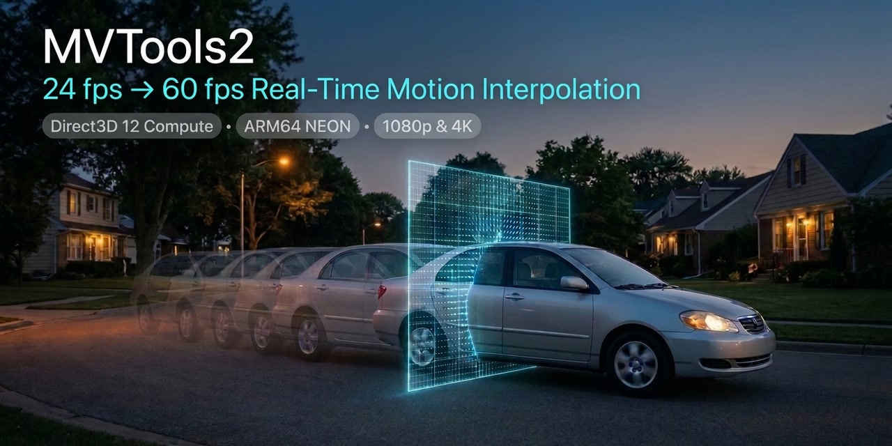

# MVTools2 — Real-Time 60 fps Video Motion Interpolation

### Native x86-64 & ARM64 Motion Estimation for Daum PotPlayer & AviSynth+

<p align="center">
  <a href="https://github.com/tordona/mvtools/releases/latest"></a>
  <a href="https://tordona.github.io/mvtools/"></a>
  <a href="Documentation/guides/"></a>
  <a href="AI_PORT_NOTICE.md"></a>
  <a href="#experimental-feature-notice-direct3d-12-gpu-offload"></a>
  <a href="#real-time-60-fps-hardware-profiles-x86-64--arm64"></a>
  <a href="Documentation/guides/"></a>
  <a href="Documentation/gpl.txt"></a>
</p>



**MVTools2** is a motion estimation and compensation plugin for AviSynth+ and the AviSynth v2.6 family, providing **real-time 24 fps → 60 fps motion interpolation** in media players like Daum PotPlayer without dropped frames.

This repository provides **51 hardware-tailored real-time profiles** across **x86-64** (AVX2 / AVX-512) and **ARM64** (NEON) platforms, an **experimental Direct3D 12 GPU offload engine**, and an automated **PresentMon sub-millisecond benchmark test harness** to verify zero dropped frames and evaluate true 1% Low frame pacing.

> 📖 **Documentation Hub:** Visit [**tordona.github.io/mvtools**](https://tordona.github.io/mvtools/) for browsable profiles, step-by-step setup guides, and benchmark analysis.

---

### Overview & Architectural Differences

| Feature                                   | Implementation                                                                                                                   | Hardware & Compatibility Notes                                                                                         |
|:----------------------------------------- |:-------------------------------------------------------------------------------------------------------------------------------- |:---------------------------------------------------------------------------------------------------------------------- |
| **Dual Architecture (x86-64 & ARM64)**    | Native AVX2/AVX-512 and ARM64 NEON SIMD vector implementations running without emulation overhead.                              | Delivers deterministic real-time 60 fps motion interpolation across 64-bit x86 and Windows on ARM devices.            |
| **Experimental Direct3D 12 GPU Offload**  | DirectCompute shaders (`MEnableD3D12(true)`) offloading vector evaluation and frame synthesis to the GPU.                        | Brings D3D12 GPU compute to AviSynth+ motion estimation.                                                               |
| **51 Tuned Real-Time Profiles**           | Curated `.avs` scripts across 8 x86-64 platforms and 9 ARM64 platforms.                                                         | Zero dropped frames, tailored core allocation, and single-level geometry (`levels=1`) preserving memory bus bandwidth. |
| **Sub-Millisecond Benchmark Harness**     | Automated PowerShell suite ([`Benchmarks/`](Benchmarks/)) measuring PresentMon ETW pacing and swapchain duplicates.              | Catches fake 60 fps swapchain repeat bugs and evaluates true 1% Low frame pacing.                                      |
| **Custom AviSynth+ Profile Generation**   | 1-click quickstart ([`GenerateCustomProfiles.md`](Documentation/guides/GenerateCustomProfiles.md)) & technical spec ([`AIAgentProfileGuide.md`](Documentation/guides/AIAgentProfileGuide.md)). | Instant tailored AviSynth+ profile generation for PotPlayer (zero clone needed) and autonomous closed-loop PresentMon tuning. |

---

### Plugin Binaries & Architecture

* **`mvtools2.dll`**: Unified canonical binary containing the production native CPU SIMD vector engine (AVX2/AVX-512 on x86-64, NEON on ARM64) and the experimental Direct3D 12 DirectCompute GPU offload engine (activated via `MEnableD3D12(true)`).
* **`AvsAffinity.dll`**: Bundled companion AviSynth+ clip filter (`PinWorkerThreads`) that enforces CPU Performance core (P-core) thread affinity for multi-threaded `Prefetch()` pipelines across hybrid topologies (Intel Alder/Raptor Lake/Core Ultra, AMD Zen 4c/5c, Qualcomm Snapdragon X2/C/8cx, NVIDIA RTX Spark), eliminating micro-stutters and 1% low frame latency caused by thread migration to Efficiency cores. Distributed standalone at [`tordona/AvsAffinity`](https://github.com/tordona/AvsAffinity) and bundled directly within `mvtools` release packages.

> [!WARNING]
> **Experimental Feature Notice (Direct3D 12 GPU Offload):**  
> Direct3D 12 GPU offload (`MEnableD3D12(true)`) is provided as an **experimental preview**. Rendering fidelity, motion vector precision, and real-time performance are provided on a **best-effort basis and are not guaranteed**. Behavior and visual output may vary depending on Qualcomm Adreno GPU architecture, Windows display driver revisions, and concurrent desktop swapchain loads.
>
> For production stability, reference image quality, and deterministic stutter-free playback, the native **CPU SIMD reference engine (`mvtools2.dll`)** remains the recommended default.

## Real-Time 60 fps Hardware Profiles (x86-64 & ARM64)

This repository provides **51 tuned real-time 60 fps AviSynth+ motion interpolation profiles** under [`AviSynth/`](AviSynth/) and configuration guides under [`Documentation/guides/`](Documentation/guides/) across 8 x86-64 and 9 ARM64 platforms:

### x86-64 Platforms (AVX2 / AVX-512)

| Platform Token | Topology / GPU | Verified Profiles | Hardware Spec |
|:--- |:--- |:--- |:---: |
| **`Generic-x64`** | Universal fallback for all 64-bit x86 systems | [Eco](AviSynth/Generic-x64-Eco.avs), [Balanced](AviSynth/Generic-x64-Balanced.avs), [MaxQuality](AviSynth/Generic-x64-MaxQuality.avs) | [`AIAgentProfileGuide.md`](Documentation/guides/AIAgentProfileGuide.md) |
| **`RyzenAI-5-340`** | 3x Zen 5 + 3x Zen 5c (12T) / Radeon 840M (RDNA 3.5) | [Eco](AviSynth/RyzenAI-5-340-Eco.avs), [Balanced](AviSynth/RyzenAI-5-340-Balanced.avs), [MaxQuality](AviSynth/RyzenAI-5-340-MaxQuality.avs) | [`AIAgentProfileGuide.md`](Documentation/guides/AIAgentProfileGuide.md) |
| **`Core-i7-11850H`** | 8C/16T Tiger Lake-H @ 45 W / Intel UHD 32EU | [Eco](AviSynth/Core-i7-11850H-Eco.avs), [Balanced](AviSynth/Core-i7-11850H-Balanced.avs), [MaxQuality](AviSynth/Core-i7-11850H-MaxQuality.avs) | [`AIAgentProfileGuide.md`](Documentation/guides/AIAgentProfileGuide.md) |
| **`Core-i5-1135G7`** | 4C/8T Tiger Lake-U @ 12–28 W / Iris Xe 80EU | [Eco](AviSynth/Core-i5-1135G7-Eco.avs), [Balanced](AviSynth/Core-i5-1135G7-Balanced.avs), [MaxQuality](AviSynth/Core-i5-1135G7-MaxQuality.avs) | [`AIAgentProfileGuide.md`](Documentation/guides/AIAgentProfileGuide.md) |
| **`Core-i5-8259U`** | 4C/8T Coffee Lake @ 28 W / Iris Plus 655 (128 MB eDRAM) | [Eco](AviSynth/Core-i5-8259U-Eco.avs), [Balanced](AviSynth/Core-i5-8259U-Balanced.avs), [MaxQuality](AviSynth/Core-i5-8259U-MaxQuality.avs) | [`AIAgentProfileGuide.md`](Documentation/guides/AIAgentProfileGuide.md) |
| **`Core-i3-1215U`** | 2P+4E/8T Alder Lake-U @ 15 W / Intel UHD 64EU (`AvsAffinity`) | [Eco](AviSynth/Core-i3-1215U-Eco.avs), [Balanced](AviSynth/Core-i3-1215U-Balanced.avs), [MaxQuality](AviSynth/Core-i3-1215U-MaxQuality.avs) | [`AIAgentProfileGuide.md`](Documentation/guides/AIAgentProfileGuide.md) |
| **`Intel-N100`** | 4C/4T Gracemont @ 6 W Fanless / Intel UHD 24EU | [Eco](AviSynth/Intel-N100-Eco.avs), [Balanced](AviSynth/Intel-N100-Balanced.avs), [MaxQuality](AviSynth/Intel-N100-MaxQuality.avs) | [`AIAgentProfileGuide.md`](Documentation/guides/AIAgentProfileGuide.md) |
| **`Core-i5-7Y54`** | 2C/4T Amber Lake @ 4.5 W Fanless / Intel HD 615 | [Eco](AviSynth/Core-i5-7Y54-Eco.avs), [Balanced](AviSynth/Core-i5-7Y54-Balanced.avs), [MaxQuality](AviSynth/Core-i5-7Y54-MaxQuality.avs) | [`AIAgentProfileGuide.md`](Documentation/guides/AIAgentProfileGuide.md) |

### ARM64 Platforms (NEON SIMD & Direct3D 12 GPU Offload)

| Platform                       | Cores / GPU                                     | Verified Profiles                                                                                                                                          | Hardware Guide                                                      |
|:------------------------------ |:----------------------------------------------- |:---------------------------------------------------------------------------------------------------------------------------------------------------------- |:------------------------------------------------------------------- |
| **RTX Spark N1X**              | 9–10x Cortex-X925 + 9–10x A725 / Blackwell RTX  | [Eco](AviSynth/RTX-Spark-N1X-Eco.avs), [Balanced](AviSynth/RTX-Spark-N1X-Balanced.avs), [MaxQuality](AviSynth/RTX-Spark-N1X-MaxQuality.avs)                | [`RTXSparkN1X.md`](Documentation/guides/RTXSparkN1X.md)             |
| **Snapdragon X2 Series**       | 6–12x Prime + 4–6x Perf Oryon / Adreno X2       | [Eco](AviSynth/Snapdragon-X2-Eco.avs), [Balanced](AviSynth/Snapdragon-X2-Balanced.avs), [MaxQuality](AviSynth/Snapdragon-X2-MaxQuality.avs)                | [`SnapdragonX2.md`](Documentation/guides/SnapdragonX2.md)           |
| **Snapdragon X Series**        | 8–12x Oryon / Adreno X1-85 (~3.8 TFLOPS)        | [Eco](AviSynth/Snapdragon-X-Eco.avs), [Balanced](AviSynth/Snapdragon-X-Balanced.avs), [MaxQuality](AviSynth/Snapdragon-X-MaxQuality.avs)                   | [`SnapdragonX.md`](Documentation/guides/SnapdragonX.md)             |
| **Snapdragon C**               | 1x Prime + 3x Perf + 4x Eff Kryo / Adreno A643  | [Eco](AviSynth/Snapdragon-C-Eco.avs), [Balanced](AviSynth/Snapdragon-C-Balanced.avs), [MaxQuality](AviSynth/Snapdragon-C-MaxQuality.avs)                   | [`SnapdragonC.md`](Documentation/guides/SnapdragonC.md)             |
| **Snapdragon 8cx Gen 3 / SQ3** | 4x X1 + 4x A78 / Adreno 690 (~2.2 TFLOPS)       | [Eco](AviSynth/Snapdragon-8cxGen3-Eco.avs), [Balanced](AviSynth/Snapdragon-8cxGen3-Balanced.avs), [MaxQuality](AviSynth/Snapdragon-8cxGen3-MaxQuality.avs) | [`Snapdragon8cxGen3.md`](Documentation/guides/Snapdragon8cxGen3.md) |
| **Snapdragon 8cx Gen 2 / SQ2** | 4x Gold + 4x Silver / Adreno 680 (~1.3 TFLOPS)  | [Eco](AviSynth/Snapdragon-8cxGen2-Eco.avs), [Balanced](AviSynth/Snapdragon-8cxGen2-Balanced.avs), [MaxQuality](AviSynth/Snapdragon-8cxGen2-MaxQuality.avs) | [`Snapdragon8cxGen2.md`](Documentation/guides/Snapdragon8cxGen2.md) |
| **Snapdragon 8cx Gen 1 / SQ1** | 4x Gold + 4x Silver / Adreno 680 (~1.1 TFLOPS)  | [Eco](AviSynth/Snapdragon-8cxGen1-Eco.avs), [Balanced](AviSynth/Snapdragon-8cxGen1-Balanced.avs), [MaxQuality](AviSynth/Snapdragon-8cxGen1-MaxQuality.avs) | [`Snapdragon8cxGen1.md`](Documentation/guides/Snapdragon8cxGen1.md) |
| **Snapdragon 850**             | 4x Gold + 4x Silver / Adreno 630 (~5 W Fanless) | [Eco](AviSynth/Snapdragon-850-Eco.avs), [Balanced](AviSynth/Snapdragon-850-Balanced.avs), [MaxQuality](AviSynth/Snapdragon-850-MaxQuality.avs)             | [`Snapdragon850.md`](Documentation/guides/Snapdragon850.md)         |
| **Snapdragon 7c Gen 2**        | 2x Gold + 6x Silver / Adreno 618 (~5 W Fanless) | [Eco](AviSynth/Snapdragon-7cGen2-Eco.avs), [Balanced](AviSynth/Snapdragon-7cGen2-Balanced.avs), [MaxQuality](AviSynth/Snapdragon-7cGen2-MaxQuality.avs)    | [`Snapdragon7cGen2.md`](Documentation/guides/Snapdragon7cGen2.md)   |

For comprehensive technical architecture and cross-compiler ABI mechanics (MSVC ARM64 $\leftrightarrow$ MinGW GCC), see [**`AI_PORT_NOTICE.md`**](AI_PORT_NOTICE.md) and [**`CHANGELOG.md`**](CHANGELOG.md).

---

## Automated Benchmark & Telemetry Test Suite

An automated benchmark harness and comparative matrix suite for reproducible frame pacing and telemetry capture is provided under [`Benchmarks/`](Benchmarks/):

- **[`MvToolsBenchmark-Start.ps1`](Benchmarks/MvToolsBenchmark-Start.ps1)**: Automated PotPlayer test harness with PresentMon frame timing (Avg FPS, 1% Lows, 0.1% Lows), hardware platform autodetection (ARM64 & x86-64), and deterministic configuration enforcement.
- **[`MvToolsBenchmarks-Compare.ps1`](Benchmarks/MvToolsBenchmarks-Compare.ps1)**: Automated 3×2 comparative matrix runner and Markdown/CSV report generator comparing **Eco vs. Balanced vs. MaxQuality** and **ARM64 CPU NEON / x64 CPU SIMD vs. Direct3D 12 GPU**.
- **[`Benchmarks/Baseline/`](Benchmarks/Baseline/)**: Verified baseline performance matrices and comparative pacing reports across ARM64 and x86-64 platforms.
- **[`Documentation/guides/GenerateCustomProfiles.md`](Documentation/guides/GenerateCustomProfiles.md)**: Custom AviSynth+ Profiles Quickstart — instant 1-click generation of tailored 3-tier profiles (`Eco`, `Balanced`, `MaxQuality`) for use in PotPlayer with zero cloning or tools required.
- **[`Documentation/guides/AIAgentProfileGuide.md`](Documentation/guides/AIAgentProfileGuide.md)**: AI Agent Technical Specification & Tuning Guide for closed-loop benchmark validation and telemetry diagnosis.

See the [**Benchmark Test Suite Documentation**](Benchmarks/README.md) for complete parameter references, usage guides, and verified baseline metrics.

## Credits:

- Manao, Fizick, Tsp, TSchniede, SEt, Vit, Firesledge, cretindesalpes 
- Intel Corporation for Intel® PresentMon (MIT License; see [`Benchmarks/PresentMon-LICENSE.txt`](Benchmarks/PresentMon-LICENSE.txt))

## Links

- Doom9 forum: https://forum.doom9.org/showthread.php?t=173356
- Avisynth wiki: http://avisynth.nl/index.php/MVTools
- Project host: https://github.com/pinterf/mvtools under mvtools-pfmod branch
- http://avisynth.nl/index.php/External_filters#64-bit_filters 
- http://avisynth.org.ru/mvtools/mvtools2.html
- DTL's fork (experimental features, hardware device motion estimation): https://github.com/DTL2020/mvtools

## System Requirements & Dependencies

### Required Runtime Dependencies
* **Microsoft Visual C++ 2015–2022 Redistributable**:
  - [ARM64 Runtime Direct Download](https://aka.ms/vs/17/release/vc_redist.arm64.exe) (Windows on ARM64)
  - [x64 Runtime Direct Download](https://aka.ms/vs/17/release/vc_redist.x64.exe) (AMD / Intel x86-64 PCs)
* **AviSynth+ Host**: AviSynth.dll (v3.7.2 or newer, matching target architecture).
* **DirectX 12 Compatible GPU**: Required only when running the experimental Direct3D 12 engine (mvtools2.dll).

### Bundled Companion Dependencies
* **AvsAffinity.dll**: Bundled alongside `mvtools2.dll` to manage CPU thread affinity on hybrid Intel, AMD, and ARM64 platforms. Automatically deployed by `Install-MvToolsPotPlayer.ps1`.

### Optional Dependencies
* **libfftw3f-3.dll**: Only required if explicitly enabling frequency-domain DCT motion estimation modes (dct >= 5). All standard real-time 60 fps profiles in this repository default to spatial SAD/SATD (dct=0) and do not require FFTW.

## Build Instructions

This fork is designed for **Windows (ARM64 and x86-64)**. Due to native Direct3D 12 GPU compute shaders and Windows Runtime APIs, Linux builds are not supported in this repository; use upstream [`pinterf/mvtools`](https://github.com/pinterf/mvtools) for Linux and macOS environments.

Compilation is performed using **Microsoft Visual Studio 2022 or 2026** via [`mvtools.sln`](mvtools.sln).

### Prerequisites

1. **Visual Studio 2022 or 2026** with the **Desktop development with C++** workload.
2. **Windows 10 / 11 SDK** (version 10.0.19041.0 or higher).
3. **Target-Specific Dependencies:**
   - **ARM64 Builds:** Install the **MSVC v143 - VS 2022 C++ ARM64/ARM64EC build tools** component from the Visual Studio Installer.
   - **x86-64 / Win32 Builds:** Install [NASM (Netwide Assembler)](https://www.nasm.us/) and enable the Visual Studio build integration via [VSNASM](https://github.com/ShiftMediaProject/VSNASM/releases) (`nasm.props` / `nasm.targets`).

---

### Building in Visual Studio (Recommended)

1. Open [`mvtools.sln`](mvtools.sln) in Visual Studio.
2. Select your build target:
   - **Native ARM64 (Windows on ARM64):**
     - Configuration: **`Release`**
     - Platform: **`ARM64`**  
     *(NASM is automatically bypassed on ARM64; ARM64 NEON intrinsics and Direct3D 12 shaders compile directly via MSVC).*
   - **x86-64 (AMD / Intel):**
     - Configuration: **`Release`**
     - Platform: **`x64`**
3. Build the solution (**`Build` -> `Build Solution`** or **`Ctrl+Shift+B`**).
4. Output binaries are generated under `Sources\<Platform>\<Configuration>\`:
   - `mvtools2.dll` (Direct3D 12 GPU and SIMD motion estimation engine)
   - `DePan.dll`
   - `DePanEstimate.dll`

---

### Command-Line Build (MSBuild)

From a **Developer Command Prompt for Visual Studio**:

```cmd
:: Build native ARM64 release
msbuild mvtools.sln /p:Configuration=Release /p:Platform=ARM64 -m

:: Build x86-64 release
msbuild mvtools.sln /p:Configuration=Release /p:Platform=x64 -m
```
