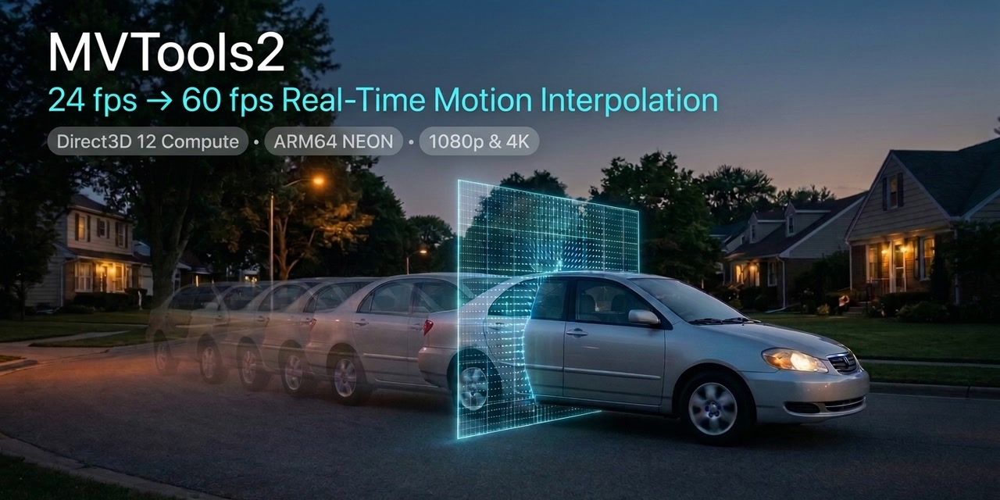

# MVTools2 — Real-Time 60 fps Documentation Hub

> **Documentation, verified 60 fps AviSynth+ profiles, and sub-millisecond PresentMon benchmark test suite for x86-64 and ARM64 in Daum PotPlayer.**

---

## Welcome to the Documentation Hub

**MVTools2** is a motion estimation and compensation plugin for AviSynth+ and the AviSynth v2.6 family, providing **real-time 24 fps → 60 fps motion interpolation** in media players like Daum PotPlayer without dropped frames.

This documentation hub covers the key architectural additions developed in this fork:
* **Dual Architecture Support:** Native AVX2/AVX-512 SIMD (x86-64) and NEON SIMD (ARM64) running without emulation overhead.
* **Experimental Direct3D 12 GPU Offload:** DirectCompute shader acceleration (`MEnableD3D12(true)`).
* **51 Tuned Real-Time Profiles:** Hardware-tailored `.avs` scripts across 8 x86-64 platforms and 9 ARM64 platforms with single-level geometry (`levels=1`) preserving memory bus bandwidth.
* **PresentMon Benchmark Test Suite:** Sub-millisecond ETW frame pacing capture with automated swapchain duplication detection.
* **AI Agent Auto-Tuning Guide:** Standardized 1-step prompt and diagnostic decision matrix for autonomous tuning.
* **CPU Core Affinity Isolation:** Companion `AvsAffinity.dll` (`PinWorkerThreads`) filter restricting AviSynth+ worker threads to Performance cores on hybrid architectures.

---

## 🖥️ Verified 60 fps Hardware Profiles

Step-by-step PotPlayer hardware decoding (D3D11 Copy-Back), video renderer selection, and profile configuration across x86-64 and ARM64 platforms:

### x86-64 Platforms (AVX2 / AVX-512)

| Platform Token | Topology / GPU | Verified Profiles | Hardware Spec |
|:--- |:--- |:--- |:---: |
| **`Generic-x64`** | Universal fallback for all 64-bit x86 systems | `Eco`, `Balanced`, `MaxQuality` | [View Spec ➔](profiles/README.md#part-ii-x86-64-hardware-profiles-amd-intel) |
| **`RyzenAI-5-340`** | 3x Zen 5 + 3x Zen 5c (12T) / Radeon 840M (RDNA 3.5) | `Eco`, `Balanced`, `MaxQuality` | [View Spec ➔](profiles/README.md#part-ii-x86-64-hardware-profiles-amd-intel) |
| **`Core-i7-11850H`** | 8C/16T Tiger Lake-H @ 45 W / Intel UHD 32EU | `Eco`, `Balanced`, `MaxQuality` | [View Spec ➔](profiles/README.md#part-ii-x86-64-hardware-profiles-amd-intel) |
| **`Core-i5-1135G7`** | 4C/8T Tiger Lake-U @ 12–28 W / Iris Xe 80EU | `Eco`, `Balanced`, `MaxQuality` | [View Spec ➔](profiles/README.md#part-ii-x86-64-hardware-profiles-amd-intel) |
| **`Core-i5-8259U`** | 4C/8T Coffee Lake @ 28 W / Iris Plus 655 (128 MB eDRAM) | `Eco`, `Balanced`, `MaxQuality` | [View Spec ➔](profiles/README.md#part-ii-x86-64-hardware-profiles-amd-intel) |
| **`Core-i3-1215U`** | 2P+4E/8T Alder Lake-U @ 15 W / Intel UHD 64EU (`AvsAffinity`) | `Eco`, `Balanced`, `MaxQuality` | [View Spec ➔](profiles/README.md#part-ii-x86-64-hardware-profiles-amd-intel) |
| **`Intel-N100`** | 4C/4T Gracemont @ 6 W Fanless / Intel UHD 24EU | `Eco`, `Balanced`, `MaxQuality` | [View Spec ➔](profiles/README.md#part-ii-x86-64-hardware-profiles-amd-intel) |
| **`Core-i5-7Y54`** | 2C/4T Amber Lake @ 4.5 W Fanless / Intel HD 615 | `Eco`, `Balanced`, `MaxQuality` | [View Spec ➔](profiles/README.md#part-ii-x86-64-hardware-profiles-amd-intel) |

### ARM64 Platforms (NEON SIMD & Direct3D 12 GPU Offload)

| SoC Platform | Target Hardware / Devices | Tuned Profiles | Hardware Setup Guide |
| :--- | :--- | :--- | :---: |
| **RTX Spark N1X** | Arm Cortex-X925/A725, Blackwell RTX GPU | `Eco`, `Balanced`, `MaxQuality` | [View Guide ➔](guides/RTXSparkN1X.md) |
| **Snapdragon X2 Series** | 3rd-Gen Oryon (18C / 12C / 10C / 6C), Adreno X2 | `Eco`, `Balanced`, `MaxQuality` | [View Guide ➔](guides/SnapdragonX2.md) |
| **Snapdragon X Series** | Surface Pro 11, Galaxy Book4 Edge, Dell XPS 13 | `Eco`, `Balanced`, `MaxQuality` | [View Guide ➔](guides/SnapdragonX.md) |
| **Snapdragon C** | 8-Core Kryo (1+3+4), Adreno A643 (~5 W – 10 W) | `Eco`, `Balanced`, `MaxQuality` | [View Guide ➔](guides/SnapdragonC.md) |
| **Snapdragon 8cx Gen 3 / SQ3** | Lenovo ThinkPad X13s, Surface Pro 9 5G | `Eco`, `Balanced`, `MaxQuality` | [View Guide ➔](guides/Snapdragon8cxGen3.md) |
| **Snapdragon 8cx Gen 2 / SQ2** | Microsoft Surface Pro X SQ2 | `Eco`, `Balanced`, `MaxQuality` | [View Guide ➔](guides/Snapdragon8cxGen2.md) |
| **Snapdragon 8cx Gen 1 / SQ1** | Microsoft Surface Pro X SQ1 | `Eco`, `Balanced`, `MaxQuality` | [View Guide ➔](guides/Snapdragon8cxGen1.md) |
| **Snapdragon 850** | Samsung Galaxy Book2, Lenovo Yoga C630 | `Eco`, `Balanced`, `MaxQuality` | [View Guide ➔](guides/Snapdragon850.md) |
| **Snapdragon 7c Gen 2** | Samsung Galaxy Book Go (Fanless 4 GB) | `Eco`, `Balanced`, `MaxQuality` | [View Guide ➔](guides/Snapdragon7cGen2.md) |

---

## ⚡ Core Sections

* [**Quick Start Setup Guide**](quickstart.md)  
  Get up and running with 60 fps video interpolation in PotPlayer in under 3 minutes.

* [**AviSynth+ Profile Library**](profiles/README.md)  
  Explore all 51 profiles across x86-64 and ARM64, inspect parameter settings, and copy `.avs` scripts directly.

* [**Benchmark & Telemetry Suite**](benchmarks/README.md)  
  Learn how to run `MvToolsBenchmark-Start.ps1`, measure PresentMon ETW 1% Low frame pacing, detect swapchain frame duplication, and compare baseline results.

* [**Custom Profiles Quickstart**](guides/GenerateCustomProfiles.md)  
  Generate custom 60 fps AviSynth profiles for use in PotPlayer in seconds with an AI assistant (no Git or cloning required).

* [**AI Agent Profile Tuning & Specification Guide**](guides/AIAgentProfileGuide.md)  
  Full architectural specification and closed-loop PresentMon benchmark tuning instructions for AI agents and performance engineers.

---

## 📦 Binaries & Downloads

Download official pre-compiled releases from the [GitHub Releases Page](https://github.com/tordona/mvtools/releases):
* **`mvtools2.dll`** : AviSynth+ motion estimation filter for ARM64 and x86-64 platforms. Delivers real-time 60 fps frame interpolation via native CPU vector extensions (NEON, AVX2) or Direct3D 12 GPU shaders.
* **`AvsAffinity.dll`** : Companion filter restricting AviSynth worker threads to Performance cores on hybrid architectures.